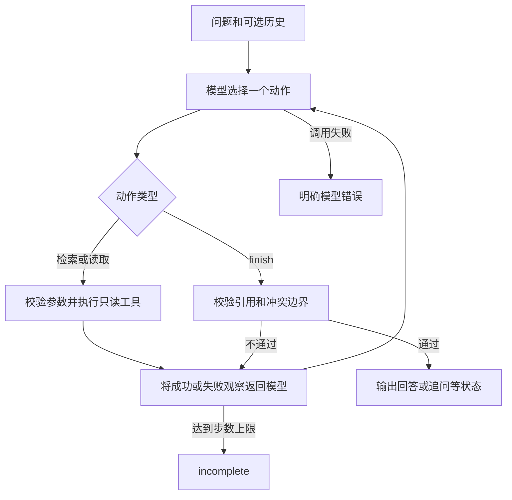

# 方案与动态决策

## 架构与职责

`documents.py` 加载并校验合成 JSON，提供两个只读业务工具。`search_documents(query, limit, reason)` 返回候选文档元数据、相关分数和截断标记；`read_document(document_id, reason)` 返回原文、片段及版本信息。搜索结果不直接作为引用证据。

`protocol.py` 定义业务工具和 `finish` 的参数 schema，并在模型返回后再次校验参数。`finish` 仅是结构化结果提交动作，不是业务写入工具。

`agent.py` 不预设“冲突后必须调用哪个工具”等业务路径，而是将实际观察交回后端，等待后端下一次选择。执行器只负责白名单、参数校验、调用上限、工具执行、证据门禁和实际日志。

`backends.py` 的 `LiveBackend` 通过 HTTP 请求配置的模型，以 function tools 接收下一步动作。`MockBackend` 是明确的规则测试替身，包含少量查询改写、指代消解和失败重试规则；它不能证明真实模型具备这些能力。两者不自动互相切换。

## 循环

真实模式的下一步来自新的模型响应，工具返回错误也进入观察；执行器没有自动业务重试。当前两条已记录的离线路径为：

- [正常路径](../examples/mock/normal.json)：检索 → 读取 D01 → 提交有引用的答案。
- [冲突路径](../examples/mock/conflict.json)：检索 → 读取 D01 → 读取 D02 → 提交双方引用与确认问题。

还有[补查路径](../examples/mock/paraphrase.json)和[失败恢复路径](../examples/mock/transient_recovery.json)。这些均为规则 Mock 的实际执行记录，真实模型路径仍需另行运行验证。

## 引用与冲突门禁

正常回答至少有一个引用，且本次至少完成一次成功检索。每条引用必须满足文档已成功读取、片段 ID 存在、quote 等于该片段的完整 text。不能将“30天”中的“0天”单独截取成不同结论，也不能删除限定条件。最终正常答案由已验证的完整引文抽取生成；其他状态的主回答使用运行时固定说明，冲突状态展示双方完整引文，均不直接显示模型自由撰写的事实性总结。这牺牲了部分自然表达和综合推理能力，换取来源可核对。模型提供的缺口和追问保留为请求确认信息，仍需人工检查相关性。

人工标注的 `claim_key`、`claim_value`、`scope` 帮助在小型合成资料上检测“同事项、同范围、不同值”。例如同一报销期限出现30天和15天时，即使 D02 日期较新，也不允许直接 answered。确认结果需要引用双方，且引文中必须包含对应具体值；不能只引用“员工”等共同词掩盖冲突。

标注不是生产级规则引擎。没有标注的自然语言冲突依赖模型发现；不同范围之间是否重叠也未自动推断。当前采取保守策略，不提供自动接受制度优先级的配置；需要适用确认时应停止并追问。

## 检索取舍

检索将中文连续片段分成双字词，同时保留英文和数字词项；用语料词频计算简单 IDF 权重，标题匹配权重更高。它不是向量检索或完整 BM25。选择该方案是为了零依赖、可解释、便于替换资料重现，而不是宣称拥有通用语义召回。

同义表达优先由模型改写查询；首次无命中并不代表全库无答案。所有候选先核对原文能减少单取首条导致的漏冲突，但代价是可能读取更多无关候选、消耗更多步数。每一条截断查询都必须用同一查询扩大 limit，直到返回不再截断；其他新查询不能清除历史截断。检索超出20条时先请求缩小范围，不直接回答。更大资料库或通用权限过滤需要另行设计。

## 错误与状态

工具返回结构化 `ok` 和 `error.code/message/retryable`。模型根据观察选择重试、补查或停止；当前 Mock 对可重试错误最多再试一次。Live 的行为不能假定相同。

正常答案为 answered；确认事项为 needs_clarification；没有资料为 no_answer；模型或工具不可用为 tool_error；达到执行上限为 incomplete。检索和原文成功记录在同次执行中保留，后续失败不会抹去已有 Trace。

## 版本与接口参考

Python 标准库实现，未使用 Agent 框架，无框架版本需要声明。HTTP 适配器按 [OpenAI 官方 Function calling 文档](https://developers.openai.com/api/docs/guides/function-calling) 的工具调用和 tool 消息形式实现，兼容服务仍需实际验证。实际 Python 版本见评估报告。
